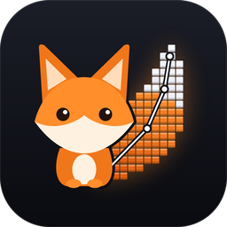

<div align="center">



# Trove-GR

<!-- Project status -->


<!-- Platforms -->

-0078D6?style=for-the-badge&logo=windows&logoColor=white)

<!-- Tech stack -->


<!-- Project meta -->

[](https://foxhearth.com/discord)
[](https://foxhearth.com/projects/trove-gr)
[](https://aallynreed.github.io/Trove-GR/)

</div>

See Trove creatures move in the browser. Drop a creature's `.blueprint` parts or a mod's `.tmod`, and each part lands on the attach point the game itself binds it to, on the creature's own Granny skeleton, ready to play every animation that rig has. Nothing gets uploaded.

It started as the creature viewer in [KiwiAPI](https://github.com/AallynReed/KiwiAPI) and is now a standalone app, with the game's 325 rigs and their 3,254 animation clips built in.

## Features

- **Parts land where the game puts them.** Placement comes from the game's own prefab bindings, never from part names. A part the bindings don't cover is listed as not placed, with the reason, instead of being guessed onto a joint.
- **Every animation.** Clips are grouped by action (idle, move, combat, emote and so on), and multi-clip moves such as a jump (begin, hold, land) play as one, read from the rig's own animation state machine.
- **Browse rigs on their own.** Pick any rig to play its clips with nothing dropped. Small cubes mark each attach point, blue for the ones on the head.
- **Game creatures.** Open an extracted `blueprints` folder, then pick a creature under **Creatures** to assemble it exactly as the game's prefab does.
- **Your own decoded rigs.** **Rigs folder** loads rigs written by the [decoder](tools/granny/README.md) instead of the built-in set, for example after a game update.
- **Trove's lighting.** Voxels are drawn with the game's object shader and specular atlas, glass and glow included. Move the sun, change the backdrop, save a PNG.
- **Private.** Files are read from your disk and never leave the machine.

## Quick start

```bash
npm ci
npm run dev
```

Open the printed URL, then drop parts on the page, choose **Open parts** or **Open folder**, or pick a rig on the left. The same works on the [hosted version](https://aallynreed.github.io/Trove-GR/).

Accepted input: loose `.blueprint` files (versions 3, 4 and 5), folders of them, and `.tmod` mods. The `.tmod` reader handles both the zlib stream and the checksum-verified stored-block framing Trove writes.

## How parts are placed

The bindings in `public/data/bindings.json` list, for each game prefab, which blueprint goes on which attach point of which skeleton, plus any per-part mesh scale and the creature's head scale. Placement follows the reference server's rules exactly:

1. Each dropped blueprint's name is looked up in the bindings. If it isn't there, only a `[style]` tag and an `_lvlN` tier suffix may be stripped, and only onto a name the bindings already list.
2. The skeleton most of the matched parts belong to wins; ties go to the one seen first.
3. Each part goes on the exact attach point its binding names. Parts bound to another skeleton, or to a point the rig lacks, are listed and not drawn.
4. Parts under the skeleton's head joint draw at the creature's head scale, times any mesh scale its prefab sets.
5. Parts on the same point at the same scale merge, and a mostly glowing part buried entirely inside others moves 1.5 voxels outward, as the game data needs.

A game creature opened from **Creatures** uses its prefab's own part list. When a part name exists in several game folders, the copy sharing most folders with the prefab is used.

## Controls

| Input | Action |
| --- | --- |
| Drag | Orbit the camera |
| Right-drag or Shift-drag | Pan |
| Scroll or pinch | Zoom |
| `/` | Filter the list |
| `↑` `↓` | Move through the list |

## Data

| Path | Contents |
| --- | --- |
| `public/rigs/<rig>.rig.json` | `voxel_scale`, `ap_keys`, `rest` (attach point to a column-major 4x4 rest matrix), `bones` (`names`, `parents`, `rest_local`), `animations` (`fps`, `frames` per clip) and `rest_from` |
| `public/rigs/anim/<rig>/<clip>.anim` | One clip of attach-point transforms per frame (format below) |
| `public/rigs/graph/<rig>.graph.json` | The rig's animation state machine: nodes with the clips they play, and edges with their trigger (`onloop`, `onrequest`, ...) and blend time |
| `public/rigs/index.json` | Every rig with its attach point and clip counts (`npm run rig-index`) |
| `public/data/bindings.json` | The prefab bindings, sorted by prefab then blueprint as the reference server loads them (`npm run bindings -- <csv>`) |
| `public/brdf-map.png` | The game's specular lobe atlas |

A clip is little-endian: the 8-byte magic `TANIM1\0\0` or `TANIM2\0\0`, then `u32` attach-point count, frame count, fps and name-blob length, then the attach-point keys separated by NUL and padded to 4 bytes, then frames × points records of `f32`. A `TANIM1` record is 7 floats (position xyz, quaternion xyzw); a `TANIM2` record is 12 (position, then the column-major 3x3 linear part, used where a clip scales a part). A rig's rest pose is frame 0 of the clip its `rest_from` names (usually `unarmed_idle`), or the skeleton's bind pose when it has no clips.

The rigs, clips and graphs were decoded from the game's Granny files with the tool in [`tools/granny`](tools/granny/README.md), which also runs against a Trove install to regenerate them.

## Development

| Script | Purpose |
| --- | --- |
| `npm run dev` | Dev server with hot reload |
| `npm run build` | Production build into `dist/` |
| `npm test` | Unit tests (Node's built-in runner) |
| `npm run lint` | ESLint |
| `npm run check` | Lint, test and build, as CI does |
| `npm run corpus -- <engine.json> [rigs]` | Compare assembly with a reference fixture from the original server |
| `npm run bindings -- <csv> [out]` | Convert a bindings export into `public/data/bindings.json` |
| `npm run rig-index -- [rigs]` | Rewrite `index.json` for a rigs folder |

Node.js 22.13 or newer is required. [docs/ARCHITECTURE.md](docs/ARCHITECTURE.md) explains how the pieces fit together.

### Hosting

The GitHub Pages workflow builds `dist/` from source on every push to `main`, so the 141 MB of rig data lives in git once rather than twice. The production build is served under `/Trove-GR/`.

### Browser support

Current Chrome, Edge, Firefox and Safari with WebGL. **Open folder** uses the browser's standard folder dialog, which may word it as an "upload"; files are still only read locally.

## License

[MIT](LICENSE).

## Trademarks

Trove is a trademark of its owner, and Granny 3D is a trademark of RAD Game Tools / Epic Games. This project is not affiliated with or endorsed by either. The rig, animation and binding data were decoded from the game for use with it; no blueprints ship with this project, and no Granny SDK files are included.
